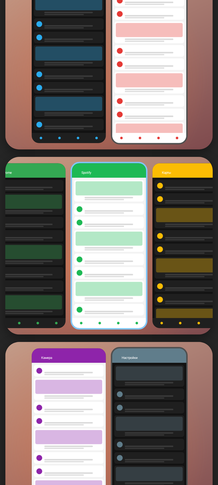
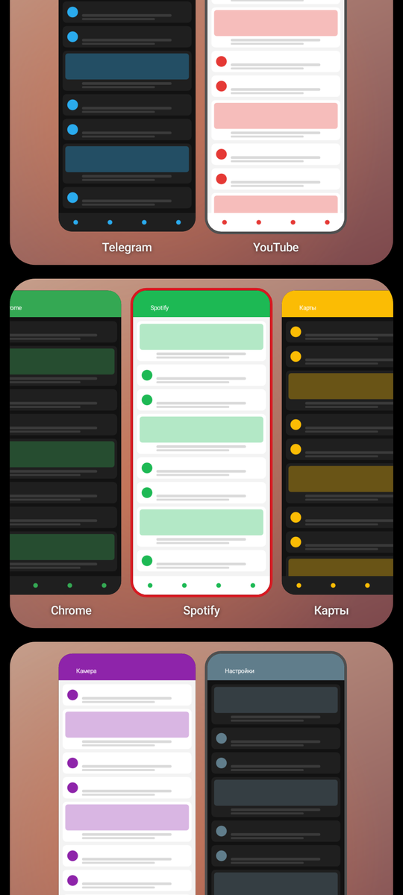

# Niri Recents

Модуль Xposed (Vector / LSPosed), который заменяет экран «Недавние приложения» на обзор в стиле
[niri](https://github.com/YaLTeR/niri) — прокручиваемого тайлового композитора для Linux.

| Цвета niri по умолчанию | Чёрный фон, красное кольцо, подписи |
|---|---|
|  |  |

## Как выглядит и работает

- **Рабочие столы друг под другом**, как в обзоре niri. Каждый стол — карточка во всю ширину
  экрана с вашими обоями; на экране сразу видно 2–3 стола и по 2–3 окна на каждом.
  Внизу всегда есть пустой стол (узкая карточка с «+»).
- **Окна — горизонтальная лента** на каждом столе; каждый стол листается отдельно.
  Окно — уменьшенная копия экрана (по умолчанию 34%).
- **Фокус-кольцо** на выбранном окне: голубое `#7fc8ff` на текущем столе, серое `#505050` на остальных.
- **Пружинные анимации niri** (критическое затухание, жёсткость 800–1000): обзор «отъезжает» из
  открытого приложения и «приезжает» обратно в выбранное окно.
- Фон за столами `#262626`, у столов тень, как `workspace-shadow`.
- Приложения в режиме разделённого экрана показываются одной колонкой из двух окон.

Управление:

| Жест | Что делает |
|---|---|
| Нажать на окно | открыть приложение |
| Листать вбок | лента окон стола под пальцем |
| Листать вверх / вниз | переход между рабочими столами |
| Смахнуть окно активного стола вверх | закрыть приложение (если столы не влезают на экран; иначе — окно любого стола) |
| Зажать окно и перетащить | на другой стол; между столами — создать новый |
| Нажать на пустое место | на главный экран |
| Назад, жест «домой» | как обычно |

Новые приложения попадают на стол, где вы были последним, и встают в конец ленты.
Расстановка запоминается.

## Установка

1. Поставьте APK.
2. Vector → Модули → **Niri Recents** → включить. В области действия отметьте лаунчер
   (на Nothing Phone это `com.nothing.launcher`).
3. Откройте Niri Recents, дайте ему root (он копирует ваши обои: лаунчеру Android 14+ их не отдаёт)
   и нажмите **«Перезапустить лаунчер»**, или перезагрузите телефон.
4. Откройте «Недавние» (свайп снизу с удержанием).

В приложении есть живой предпросмотр (уменьшенная копия экрана), настройки (размер окон, отступы,
скругление, цвета кольца и фона, обои, тени, подписи, скорость анимаций) и **диагностика**: модуль
из лаунчера пишет туда, что подключился и какие состояния видит. Если что-то не работает — скопируйте её.

Галочка «Niri-обзор вместо стандартного» в любой момент возвращает обычные «Недавние».

## Как это устроено

- Лаунчер на Android (Launcher3 Quickstep, на нём же Nothing Launcher) не обфусцирует классы
  `com.android.quickstep.**` и `com.android.systemui.shared.**`. Модуль подписывается на машину
  состояний лаунчера и, когда тот входит в состояние «Недавние», кладёт поверх полноэкранное окно
  `TYPE_APPLICATION_OVERLAY` с обзором. Такое окно лаунчеру разрешено (`SYSTEM_APPLICATION_OVERLAY`).
- Стандартные «Недавние» продолжают работать под ним: открытие и закрытие приложений идут через
  их же методы (`TaskView.launchWithAnimation`, `RecentsView.dismissTask`), поэтому живая плитка
  текущего приложения и анимации системы не ломаются.
- Снимки окон берутся из системного кэша, а для приложения, из которого вы пришли, снимается свежий.
- Каждый вызов во внутренности лаунчера идёт через рефлексию с запасными вариантами и перехватом
  ошибок. Если что-то не нашлось, показываются обычные «Недавние», лаунчер не падает.
- Оверлей не может «залипнуть»: он убирается при любом выходе из «Недавних», при выключении
  экрана, при остановке лаунчера, и его дополнительно проверяет сторожевой таймер.

## Что не повторяет стандартные «Недавние»

- Нет кнопок «Скриншот» и «Выбрать», нет «Очистить всё» (в niri их тоже нет).
- Пока жест вверх удерживается, видна стандартная карточка; niri-обзор появляется после отпускания.

## Сборка

```
cd NiriRecents
./gradlew assembleRelease            # app/build/outputs/apk/release/app-release.apk
./gradlew testDebugUnitTest          # логика столов, пружины, отрисовка в PNG (Robolectric)
```

Если Maven Central ограничивает скачивание jar-файлов Robolectric, их можно положить в папку и
передать `-ProbolectricDir=/путь/к/папке`.

Тесты рисуют обзор в `app/build/preview/*.png`. С `-PpreviewThumbs=/папка/со/скриншотами` и
`-PpreviewWallpaper=/обои.png` вместо нарисованных окон будут настоящие картинки.
